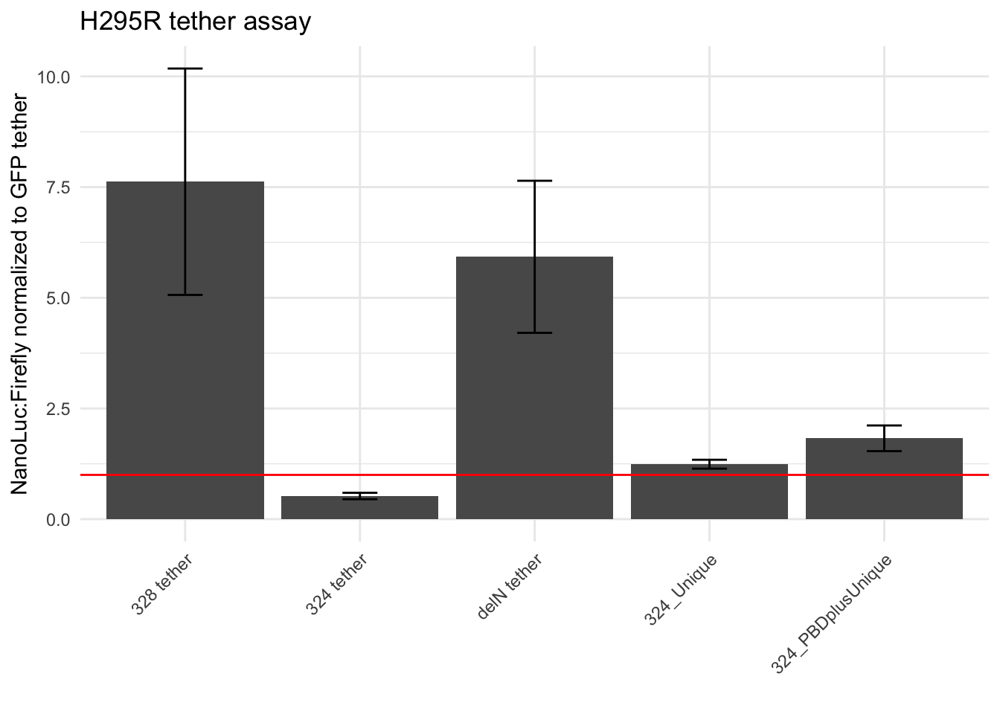
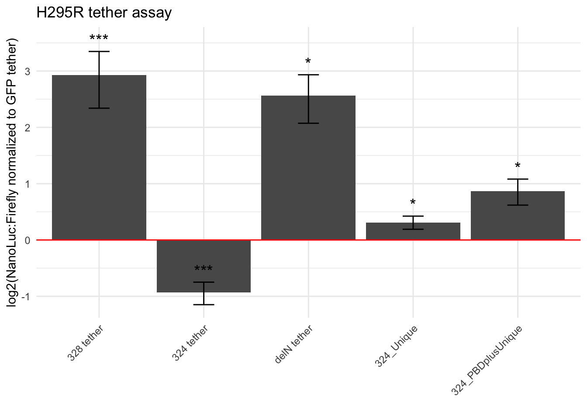
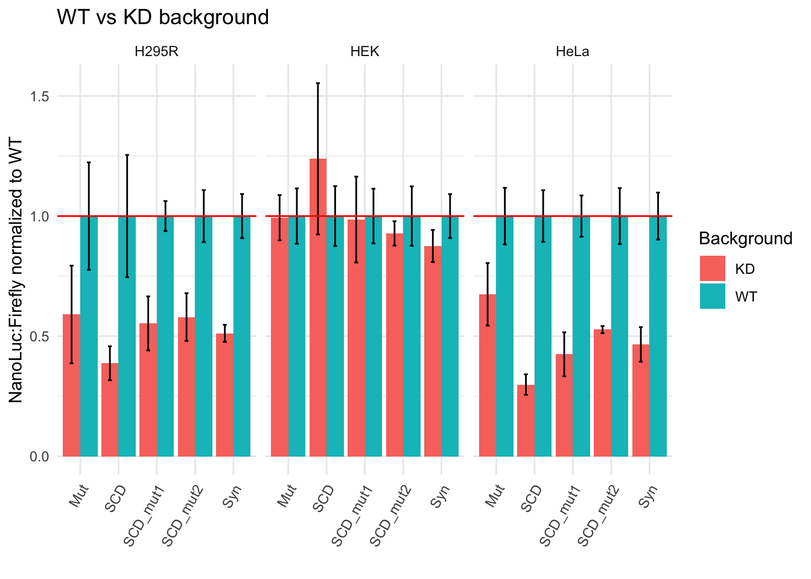

``` r
library(readxl)
library(tidyverse)
```

```
## ── Attaching core tidyverse packages ──────────────────────── tidyverse 2.0.0 ──
## ✔ dplyr     1.1.4     ✔ readr     2.1.5
## ✔ forcats   1.0.1     ✔ stringr   1.5.2
## ✔ ggplot2   4.0.0     ✔ tibble    3.3.0
## ✔ lubridate 1.9.4     ✔ tidyr     1.3.1
## ✔ purrr     1.1.0     
## ── Conflicts ────────────────────────────────────────── tidyverse_conflicts() ──
## ✖ dplyr::filter() masks stats::filter()
## ✖ dplyr::lag()    masks stats::lag()
## ℹ Use the conflicted package (<http://conflicted.r-lib.org/>) to force all conflicts to become errors
```

``` r
library(here)
```

```
## here() starts at /Users/kathrynwalters/Documents/RStudio Git Locations/2026_MSI2_isoforms
```

``` r
df <- read_excel(here::here("data", "DLAssay_ALLData.xlsx"))

plot_order <- c(
  "328 tether",
  "324 tether",
  "delN tether",
  "324_Unique",
  "324_PBDplusUnique"
)

df_h295r <- df %>%
  filter(Cell_Line == "WT_H295R" & Conc_MSI2 == 25) %>%
  mutate(
    Nano_FF = NanoGlo / Firefly,
    construct_plot = case_when(
      MSI2_Exp %in% c("328_Tether", "WT_Tether", "FullLength_Tether", "Full length_Tether") ~ "328 tether",
      MSI2_Exp == "324_Tether" ~ "324 tether",
      MSI2_Exp == "delN_Tether" ~ "delN tether",
      MSI2_Exp == "324-Unique_Tether" ~ "324_Unique",
      MSI2_Exp == "324-PBDplusUnique_Tether" ~ "324_PBDplusUnique",
      TRUE ~ NA_character_
    )
  ) %>%
  group_by(Exp) %>%
  mutate(
    GFP_Tether_mean = mean(Nano_FF[MSI2_Exp == "GFP_Tether"], na.rm = TRUE),
    GFP_norm = Nano_FF / GFP_Tether_mean
  ) %>%
  ungroup() %>%
  filter(!is.na(construct_plot)) %>%
  mutate(construct_plot = factor(construct_plot, levels = plot_order))

df_h295r_summary <- df_h295r %>%
  group_by(construct_plot) %>%
  summarise(
    n = n(),
    mean = mean(GFP_norm, na.rm = TRUE),
    sd = sd(GFP_norm, na.rm = TRUE),
    se = sd / sqrt(n),
    experiments = paste(sort(unique(Exp)), collapse = ", "),
    .groups = "drop"
  )

df_h295r_summary
```

```
## # A tibble: 5 × 6
##   construct_plot        n  mean     sd     se experiments                   
##   <fct>             <int> <dbl>  <dbl>  <dbl> <chr>                         
## 1 328 tether           16 7.62  2.56   0.639  KAB136, KAB142, KAB152, KAB157
## 2 324 tether           12 0.523 0.0720 0.0208 KAB142, KAB152, KAB157        
## 3 delN tether           4 5.93  1.72   0.859  KAB142                        
## 4 324_Unique            4 1.24  0.100  0.0501 KAB157                        
## 5 324_PBDplusUnique     4 1.83  0.290  0.145  KAB157
```

``` r
ggplot(df_h295r_summary, aes(x = construct_plot, y = mean)) +
  geom_col() +
  geom_errorbar(
    aes(ymin = mean - sd, ymax = mean + sd),
    width = 0.2
  ) +
  geom_hline(yintercept = 1, color = "red") +
  theme_minimal() +
  labs(
    x = "",
    y = "NanoLuc:Firefly normalized to GFP tether",
    title = "H295R tether assay"
  ) +
  theme(axis.text.x = element_text(angle = 45, hjust = 1))
```



``` r
stats_df <- df_h295r %>%
  group_by(construct_plot) %>%
  summarise(
    p_value = tryCatch(
      t.test(GFP_norm, mu = 1)$p.value,
      error = function(e) NA
    ),
    .groups = "drop"
  ) %>%
  mutate(
    p_adj = p.adjust(p_value, method = "BH"),
    label = case_when(
      p_adj < 0.001 ~ "***",
      p_adj < 0.01  ~ "**",
      p_adj < 0.05  ~ "*",
      TRUE ~ "ns"
    )
  )

df_plot <- df_h295r_summary %>%
  left_join(stats_df, by = "construct_plot")

df_plot <- df_plot %>%
  mutate(
    mean_log2 = log2(mean),
    ymin_log2 = log2(mean - sd),
    ymax_log2 = log2(mean + sd)
  )

ggplot(df_plot, aes(x = construct_plot, y = mean_log2)) +
  geom_col() +
  geom_errorbar(
    aes(ymin = ymin_log2, ymax = ymax_log2),
    width = 0.2
  ) +
  geom_hline(yintercept = 0, color = "red") +  # GFP baseline (log2(1)=0)
  geom_text(
    aes(label = label, y = ymax_log2 + 0.2),
    size = 5
  ) +
  theme_minimal() +
  labs(
    x = "",
    y = "log2(NanoLuc:Firefly normalized to GFP tether)",
    title = "H295R tether assay"
  ) +
  theme(axis.text.x = element_text(angle = 45, hjust = 1))
```




# Figure 1F - KD experiments


``` r
df_kd_wt <- df %>%
  filter(Exp %in% c("KAB151", "KAB153", "KAB154")) %>%
  mutate(
    Nano_FF = NanoGlo / Firefly,
    Background = case_when(
      str_detect(Cell_Line, "^WT") | MSI2_Exp == "WT" ~ "WT",
      str_detect(Cell_Line, "^KD") | MSI2_Exp == "KD" ~ "KD",
      TRUE ~ NA_character_
    ),
    Cell = case_when(
      str_detect(Cell_Line, "H295R") ~ "H295R",
      str_detect(Cell_Line, "HEK") ~ "HEK",
      str_detect(Cell_Line, "HeLa") ~ "HeLa",
      TRUE ~ Cell_Line
    )
  ) %>%
  filter(
    !is.na(Background),
    MSI2_Exp %in% c("WT", "KD"),     # removes rescues / dox / 328 constructs
    !is.na(Reporter),
    Reporter != "NA"
  )


#normalize within experiment + cell line + reporter to the WT mean
df_norm <- df_kd_wt %>%
  group_by(Exp, Cell, Reporter) %>%
  mutate(
    WT_mean = mean(Nano_FF[Background == "WT"], na.rm = TRUE),
    Norm = Nano_FF / WT_mean
  ) %>%
  ungroup() %>%
  filter(!is.na(Norm), is.finite(Norm))

#Plot WT vs KD, faceted by cell line:
df_summary <- df_norm %>%
  group_by(Cell, Reporter, Background) %>%
  summarise(
    mean = mean(Norm, na.rm = TRUE),
    sd = sd(Norm, na.rm = TRUE),
    n = n(),
    .groups = "drop"
  )

ggplot(df_summary, aes(x = Reporter, y = mean, fill = Background)) +
  geom_col(position = position_dodge()) +
  geom_errorbar(
    aes(ymin = mean - sd, ymax = mean + sd),
    width = 0.2,
    position = position_dodge(0.9)
  ) +
  geom_hline(yintercept = 1, color = "red") +
  facet_wrap(~Cell) +
  theme_minimal() +
  theme(axis.text.x = element_text(angle = 60, hjust = 1)) +
  labs(
    x = "",
    y = "NanoLuc:Firefly normalized to WT",
    title = "WT vs KD background"
  )
```




